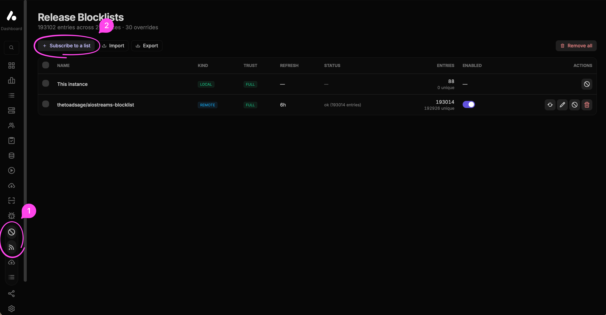
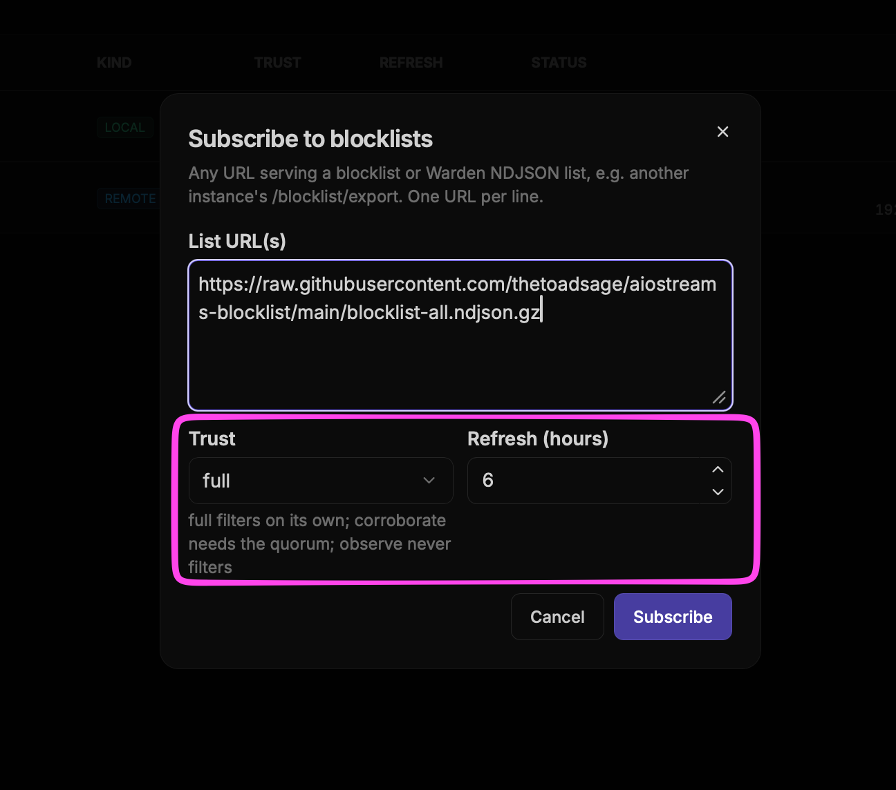

# AIOStreams blocklist

A community blocklist with **190,000+ unique items**, updated automatically every six hours.

## Add to AIOStreams

1. Open the AIOStreams **Dashboard → Blocklists → Sources**, then click **Subscribe to a list**.

   

2. Paste this address into **List URL(s)**:

   ```text
   https://raw.githubusercontent.com/thetoadsage/aiostreams-blocklist/main/blocklist-all.ndjson.gz
   ```

3. Set **Trust** to **full** and **Refresh (hours)** to **6**, then click **Subscribe**.

   

## Updates

- Checks [community sources](sources.json) every six hours.
- Always keeps the original entries. Later additions follow the current sources.
- Keeps the last working list if an update fails.

[Update status](https://github.com/thetoadsage/aiostreams-blocklist/actions/workflows/update.yml) · [Current entry count](manifest.json) · [Unavailable sources](disabled-sources.json)

## Backup

[Download the current list](blocklist-all.ndjson.gz) or the [original export](baseline/original.ndjson.gz) to import manually in AIOStreams.
