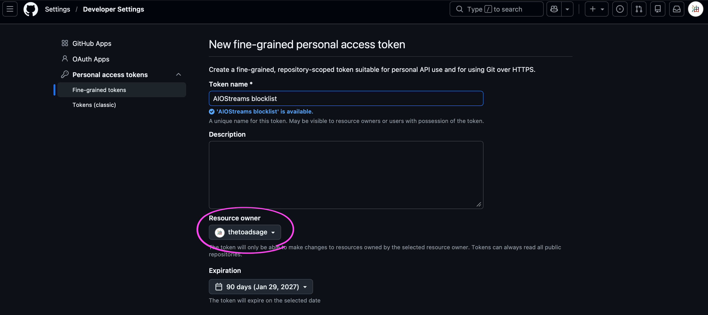
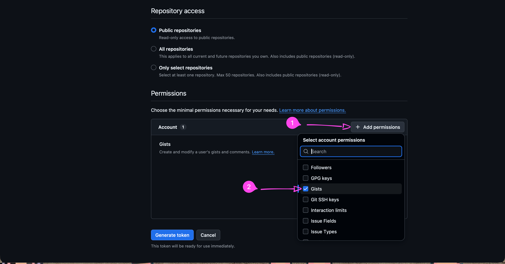
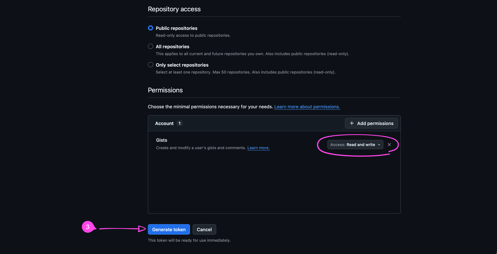
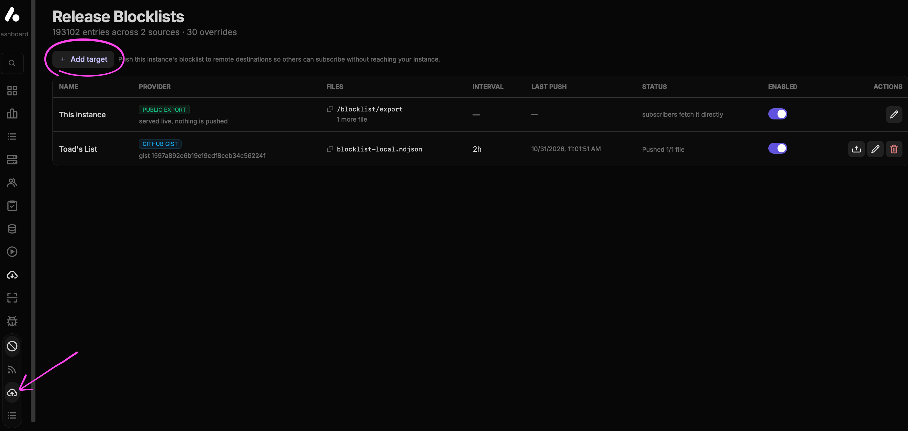
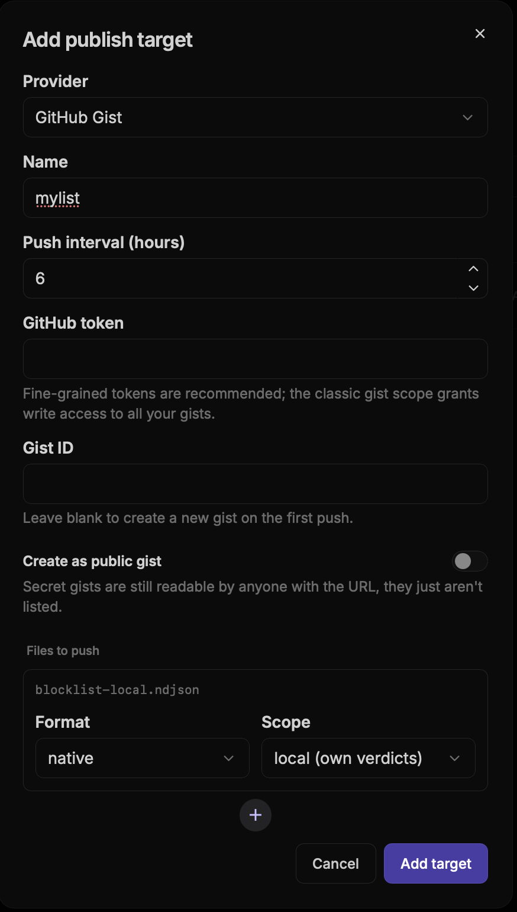
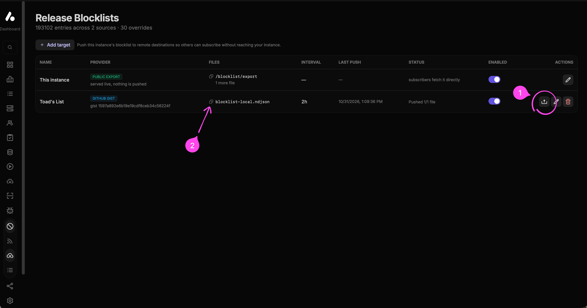

# AIOStreams blocklist

A community blocklist with **190,000+ unique items**, scheduled to update automatically every six hours.

## Add to AIOStreams

1. Open the AIOStreams **Dashboard → Blocklists → Sources**, then click **Subscribe to a list**.

   

2. Paste this address into **List URL(s)**:

   ```text
   https://raw.githubusercontent.com/thetoadsage/aiostreams-blocklist/main/blocklist-all.ndjson.gz
   ```

3. Set **Trust** to **full** and **Refresh (hours)** to **6**, then click **Subscribe**.

   

## Contribute your own blocks

Publish your instance's own blocks to a GitHub Gist so they can be included here. You'll need access to your instance's Dashboard and some locally recorded blocks.

### On GitHub — create your token

1. [Create a fine-grained GitHub token](https://github.com/settings/personal-access-tokens/new). Name it `AIOStreams blocklist`, choose **your own personal account** as **Resource owner**, and set an expiration.
2. Leave **Repository access → Public repositories** selected. Under **Permissions → Account**, click **Add permissions**, select **Gists**, and set its access to **Read and write**. Click **Generate token** and copy it. No repository write permissions are needed.

### In your AIOStreams dashboard — publish your list

3. In **Dashboard → Blocklists → Publishing**, click **Add target** and choose **GitHub Gist**.
4. Enter a name, set the push interval to **6 hours**, and paste your token into **GitHub token**. Leave **Gist ID** blank so AIOStreams creates it. Under **Files to push**, choose **native** format and **local (own verdicts)** scope. Local shares your own blocks without republishing subscribed lists. **Create as public gist** is optional; secret Gists also work and are readable by anyone with their URL.
5. Click **Add target**, then the target's **Push now** upload button. Wait for **Pushed 1/1 file**, then click the copy icon beside `blocklist-local.ndjson` in that target's row. Keep the target **Enabled** for automatic updates.

### Back on GitHub — share your list URL

6. [Open an issue](https://github.com/thetoadsage/aiostreams-blocklist/issues/new) with the copied list URL, or submit a pull request adding it to [sources.json](sources.json). Share the URL only, never your token.

Keep your token private and replace it in AIOStreams before it expires. [GitHub token guide](https://docs.github.com/en/authentication/keeping-your-account-and-data-secure/managing-your-personal-access-tokens#creating-a-fine-grained-personal-access-token).

**Need a visual guide? Click either section below to expand helpful screenshots for each step.**

<details>
<summary>GitHub token setup screenshots</summary>

Name the token, select **your own personal account** as Resource owner, and choose an expiration:



Leave Repository access on **Public repositories**. Under Account permissions, click **Add permissions** and select **Gists**:



Set Gists access to **Read and write**, then click **Generate token**. Copy the token into AIOStreams; keep it private.



</details>

<details>
<summary>AIOStreams publishing screenshots</summary>

Open Publishing and click **Add target**. The existing target shown in these screenshots uses **2h**; use **6 hours** when creating your new target as described above.



Set up a GitHub Gist target with a **6-hour** interval, **native** format and **local (own verdicts)** scope. The token field is blank in this example; paste your generated token there. Leave **Gist ID** blank.



Click **Push now** (1). When Status shows **Pushed 1/1 file**, copy the list URL using the icon beside `blocklist-local.ndjson` (2), in your Gist target's row.



</details>

## Updates

- Scheduled to check [community sources](sources.json) every six hours. [GitHub may delay or skip scheduled runs](https://docs.github.com/en/actions/reference/workflows-and-actions/events-that-trigger-workflows#schedule).
- Always keeps the original entries. Later additions follow the current sources.
- Keeps the last working list if an update fails.

[Update status](https://github.com/thetoadsage/aiostreams-blocklist/actions/workflows/update.yml) · [Current entry count](manifest.json) · [Unavailable sources](disabled-sources.json)

## Backup

[Download the current list](blocklist-all.ndjson.gz) or the [original export](baseline/original.ndjson.gz) to import manually in AIOStreams.
